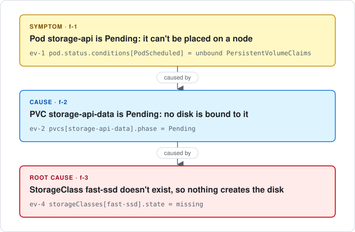

# Culprit

Culprit traces Kubernetes failures back to their root cause by following the `causedBy` chain through events, resource states, and scheduler messages.

## How it works

Each finding in a diagnosis is linked to the finding that caused it. Culprit walks that chain from the visible symptom to the terminal node — the root cause.



- **Symptom** — what you see first (e.g. a pod stuck in `Pending`)
- **Intermediate cause** — a resource that failed to satisfy the pod's requirements (e.g. a PVC that was never bound)
- **Root cause** — the terminal node where the chain ends (e.g. a StorageClass with no provisioner configured)

Each node is backed by an evidence record (`ev-N`) that points to the raw Kubernetes event or resource status that supports the finding.

## Usage

```powershell
go build -o kubectl-culprit.exe ./cmd/kubectl-culprit

kubectl-culprit storage-api                      # the chain, symptom to root cause
kubectl-culprit storage-api -o json              # the diagnosis as JSON
kubectl-culprit storage-api -o snapshot > s.json # only collect the evidence
kubectl-culprit --from s.json                    # diagnose a saved snapshot, no cluster needed
```

With `kubectl-culprit` on your `PATH`, it also runs as `kubectl culprit POD`.

It works in two steps: **collect** reads the pod and everything it depends on into a snapshot
(read-only), then **diagnose** follows the chain using only that snapshot.

## Docs

| Document | Description |
|---|---|
| [Collect requirements](docs/collect-requirements.md) | What the collect step gathers, and its rules |
| [Diagnose requirements](docs/diagnose-requirements.md) | The finding format and the rules that follow each chain |
| [Broken pods evidence](broken-pods-evidence.md) | How to prove each test pod's failure by hand |
| [Causal chain diagram](docs/causal-chain.svg) | Visual walkthrough of a pending-pod diagnosis |
