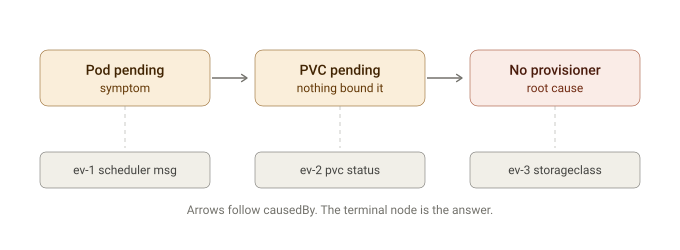

# Culprit

Culprit traces Kubernetes failures back to their root cause by following the `causedBy` chain through events, resource states, and scheduler messages.

## How it works

Each finding in a diagnosis is linked to the finding that caused it. Culprit walks that chain from the visible symptom to the terminal node — the root cause.

- **Symptom** — what you see first (e.g. a pod stuck in `Pending`)
- **Intermediate cause** — a resource that failed to satisfy the pod's requirements (e.g. a PVC that was never bound)
- **Root cause** — the terminal node where the chain ends (e.g. a StorageClass with no provisioner configured)

Each node is backed by an evidence record (`ev-N`) that points to the raw Kubernetes event or resource status that supports the finding.

## Docs

| Document | Description |
|---|---|
| [Causal chain diagram](docs/causal-chain.svg) | Visual walkthrough of a pending-pod diagnosis |
